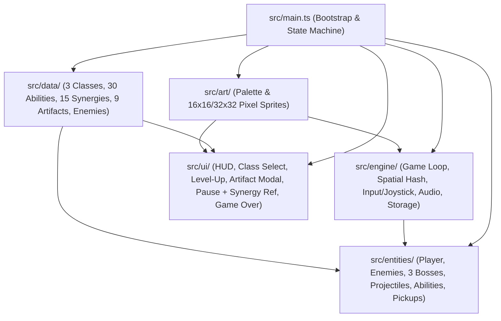

# Pastel Survivors — Implementation Plan

## Goal Description
Build **Pastel Survivors**, a complete, playable, browser-based 16x16 pixel-art bullet-heaven roguelite inspired by *Vampire Survivors*, *Magic Survival*, *Brotato*, *Archero*, and *20 Minutes Till Dawn*.

The project will be built with **HTML5 Canvas + TypeScript (Vite)** and bundled via `vite-plugin-singlefile` into a **single, completely self-contained `dist/index.html`** with zero external network or asset dependencies — ready to run offline on mobile or drop into an Android WebView / Capacitor APK wrapper.

---

## Key Design Decisions (Confirmed via Interview)
- **Active Ability Cap:** **6 active ability slots** per run; each hero starts with 1 signature ability at Lv 1.
- **Synergy Evolution (Lv 10 + Lv 10):** Unlocking a Synergy requires **both component abilities at Lv 10**. It appears as a high-priority evolution card on level-up, **disables/replaces the 2 component abilities** in favor of **1 powerful evolved Synergy ability** (freeing 1 active slot), preserves **all Lv 5 and Lv 10 permanent global passives** already earned from those two abilities, and grants an **additional permanent global passive buff**.
- **Boss Chest & Class Artifacts:** Defeating any Boss drops a **Boss Chest** in the arena. Collecting it heals the hero and opens a **Boss Artifact** reward modal granting one of **3 class-specific Artifacts** (9 total, akin to *20 Minutes Till Dawn*). Rare regular enemy drops also spawn Pastel Hearts (healing) and Magnet Orbs (pull all XP gems).
- **Audio:** **Procedural Web Audio API** pastel/chiptune SFX (hits, XP chimes, level-up jingle, synergy fanfare, boss alert) with a Mute toggle in HUD and Pause menu.
- **Persistence:** `localStorage` tracks per-class best runs (survival time, max level, max kills, bosses defeated) and audio mute preference.

---

## Architecture Overview



### Project Directory
All source files will be scaffolded under `/home/antigravity/pastel-survivors/`:

```text
pastel-survivors/
├── index.html
├── package.json
├── tsconfig.json
├── vite.config.ts
└── src/
    ├── main.ts
    ├── style.css
    ├── art/
    │   ├── palette.ts          # Soft pastel color palette tokens
    │   └── sprites.ts          # Procedural 16x16 & 32x32 offscreen canvas sprite bakery + icon data URLs
    ├── data/
    │   ├── types.ts            # Shared interfaces (ClassDef, AbilityDef, SynergyDef, ArtifactDef, etc.)
    │   ├── classes.ts          # Mage, Ranger, Knight base stats & starting abilities
    │   ├── abilities.ts        # All 30 abilities with Lv 1–10 scaling + Lv 5 & Lv 10 global passives
    │   ├── synergies.ts        # All 15 synergies (5 per class) with evolved behaviors + global passives
    │   ├── artifacts.ts        # 9 class-specific Boss Artifacts (3 per class)
    │   └── enemies.ts          # 3 enemy archetypes + 3 Boss configs + scaling formulas
    ├── engine/
    │   ├── audio.ts            # Procedural Web Audio API synthesizer (SFX + mute toggle)
    │   ├── input.ts            # Keyboard (WASD/Arrows), optional Mouse Aim, Floating Touch Joystick
    │   ├── spatialHash.ts      # Fast 2D spatial hash grid for 60 FPS collision with 300+ entities
    │   ├── storage.ts          # localStorage persistence for per-class best runs & settings
    │   └── game.ts             # Core fixed/clamped-dt game loop, camera, wave director, combat engine
    ├── entities/
    │   ├── abilityRunner.ts    # Execution logic for all 30 abilities + 15 evolved synergies
    │   └── bossAI.ts           # Telegraphing & attack state machines for King Mochi, Lady Wisteria, Aegis
    └── ui/
        └── uiManager.ts        # Responsive pixel-art HUD, Class Select, Level-Up, Artifact, Pause & Game Over
```

---

## Proposed Changes

### 1. Project Scaffold & Single-File Build
#### [NEW] `package.json`, `tsconfig.json`, `vite.config.ts`, `index.html`, `src/style.css`
- Configure Vite 6 + TypeScript 5 + `vite-plugin-singlefile` so `npm run build` outputs a single self-contained `dist/index.html` with all JS and CSS inlined.
- Configure mobile-safe viewport meta (`maximum-scale=1.0, user-scalable=no, viewport-fit=cover`) and CSS (`touch-action: none; user-select: none; overscroll-behavior: none; image-rendering: pixelated;`).
- Use system monospace / crisp pixel styling with zero external Google Fonts or CDN links.

---

### 2. Procedural 16x16 / 32x32 Pastel Art System
#### [NEW] `src/art/palette.ts` & `src/art/sprites.ts`
- **Palette:** Sage/mint ground (`#d8e8d4`, `#cde0c8`), lavender (`#c5b4e3`), peach (`#f7c5a8`), baby blue (`#a8d8f0`), soft coral (`#f29ca3`), warm cream (`#fdf6e3`), butter yellow (`#f7e6a8`), dark plum/slate (`#3a3245`) for crisp 1px outlines and text.
- **Sprite Bakery:** Bake 16x16 pixel-matrix strings onto offscreen `<canvas>` elements at startup for:
  - 3 Hero classes (2-frame walk bob + facing flip)
  - 3 Standard enemy archetypes (Fast Slime/Bat, Slow Golem/Knight, Ranged Wisp/Archer) + Mini-Slime
  - 3 Bosses at 32x32 resolution (**King Mochi**, **Lady Wisteria**, **Aegis the Porcelain Warden**)
  - Pickups (XP gems in 3 tiers, Pastel Heart, Magnet Orb, Boss Chest)
  - Projectiles, ground decorations (tiny pastel flowers, clover, pebbles)
  - Distinct 16x16 UI icons for all 30 abilities, 15 synergies, and 9 class artifacts (exported as cached data URLs for crisp `` rendering in HUD, Level-Up cards, and Pause Synergy Reference Panel).

---

### 3. Data-Driven Classes, 30 Abilities, 15 Synergies & 9 Boss Artifacts
#### [NEW] `src/data/types.ts`, `src/data/classes.ts`, `src/data/abilities.ts`, `src/data/synergies.ts`, `src/data/artifacts.ts`

- **Hero Classes:**
  1. **Mage** (`HP: 85`, `Speed: 118`, `Pickup: 72`, `Armor: 0%`) — Starts with **Fireball**.
  2. **Ranger** (`HP: 95`, `Speed: 138`, `Pickup: 80`, `Armor: 0%`) — Starts with **Twin Pistols**.
  3. **Knight** (`HP: 135`, `Speed: 112`, `Pickup: 68`, `Armor: 15%`) — Starts with **Greatsword Cleave**.

- **30 Abilities (10 per class, Lv 1–10):**
  - Each ability defines base stats (`damage`, `cooldown`, `count`, `area`, `pierce`, `duration`, `speed`), per-level upgrade steps from Lv 2 to Lv 10, a **Lv 5 permanent global passive** (e.g., `+8% All Damage`, `-5% All Cooldowns`, `+10% All Area`, `+5% Move Speed`, `+10% Pickup Radius`), and a stronger **Lv 10 permanent global passive** (e.g., `+14% All Damage`, `-8% All Cooldowns`, `+15% All Area`).

- **15 Synergies (5 per class, unlocked at Lv 10 + Lv 10):**
  - **Mage:**
    1. *Fireball + Wind Blade* = **Firestorm** (blazing tornado fireballs that pull & scorch)
    2. *Ice Shard + Frost Nova* = **Absolute Zero** (shattering glacial rings + freezing lances)
    3. *Chain Lightning + Plasma Beam* = **Tempest Lance** (wide piercing lightning laser that arcs to nearby foes)
    4. *Arcane Orb + Shadow Bolt* = **Eclipse Singularity** (orbiting dark-arcane orbs firing homing void bolts)
    5. *Earth Spike + Meteor Rain* = **Cataclysm** (giant meteors erupting into radial earth-spike shockwaves)
  - **Ranger:**
    1. *Twin Pistols + Homing Arrow* = **Smart Bullets** (rapid-fire curving auto-lock rounds)
    2. *Magic Longbow + Piercing Rail-Bow* = **Starlight Railgun** (hyper-velocity screen-wide beam arrows)
    3. *Shotgun Blast + Explosive Crossbow* = **Cluster Cannon** (cone of explosive shrapnel shells)
    4. *Ricochet Revolver + Frost Quiver* = **Glacial Ricochet** (chilling bouncing bullets that slow & splinter)
    5. *Gatling Turret + Rain of Arrows* = **Artillery Barrage** (auto-turrets calling down continuous arrow volleys)
  - **Knight:**
    1. *Greatsword Cleave + Orbiting Blades* = **Whirlwind Tempest** (360° rapid blade cyclone + orbiting greatswords)
    2. *Shield Bash + Shockwave Stomp* = **Bastion Quake** (massive knockback slams with double shockwave rings)
    3. *Spinning Axe + Chain Flail* = **Reaper's Pendulum** (heavy spiraling boomerang flail-axes)
    4. *Ground Slam + Holy Hammer* = **Divine Judgment** (falling sacred hammers that trigger seismic craters)
    5. *Spear Thrust + Blade Dash* = **Valkyrie Blitz** (rapid phantom spear-dashes cutting through packs)
  - **Passive Preservation Rule:** When a Synergy activates, the two Lv 10 abilities are marked `consumed` (removed from active firing & freeing 1 of the 6 active slots), while their Lv 5 & Lv 10 global passive buffs remain permanently in the player's `globalPassives` ledger, plus the Synergy adds its own bonus global passive!

- **9 Boss Artifacts (3 per class, dropped from Boss Chests):**
  - **Mage:** *Prismatic Focus* (+25% All Area, +15% Crit), *Aether Chronometer* (-18% All Cooldowns, every 5th cast double-casts), *Mana Conduit* (+35% XP Gain, +18% All Damage).
  - **Ranger:** *Quicksilver Quiver* (-20% All Cooldowns, +15% Move Speed), *Split-Fletching Charm* (+1 Projectile & +1 Pierce to all abilities), *Hawkeye Monocle* (+25% Crit Chance, 2.0x Crit Multiplier).
  - **Knight:** *Valkyrie Crest* (+45 Max HP, +2 HP/s Regen, +10% Armor), *Titan's Gauntlet* (+30% All Damage, +40% Knockback), *Retribution Aegis* (Taking damage triggers a pastel shockwave & +25% Damage for 4s).
  - If all 3 class artifacts are already collected (past 30:00), subsequent Boss Chests grant an **Ascended Relic** (+15% All Damage, +20 Max HP, Full Heal).

---

### 4. Core Engine, Combat, Spatial Hash & Boss AI
#### [NEW] `src/engine/spatialHash.ts`, `src/engine/input.ts`, `src/engine/audio.ts`, `src/engine/storage.ts`, `src/engine/game.ts`, `src/entities/abilityRunner.ts`, `src/entities/bossAI.ts`
- **Spatial Partitioning:** Cell-based spatial hash (64px cells) rebuilt/updated each frame for fast enemy-projectile, enemy-player, and enemy-separation queries at 60 FPS with 300+ enemies.
- **Scaling Formulas:**
  - `xpNeeded(level) = Math.floor(10 + level * 8 + Math.pow(level, 1.5) * 4)`
  - `enemyHP = baseHP * (1 + 0.18 * t + 0.03 * t * t)` (where `t` is elapsed minutes)
  - `enemyXP = baseXP * (1 + 0.12 * t)`
  - Spawn rate & enemy archetype mix scale smoothly with `t`.
- **Boss Cadence & Behaviors:**
  - Spawns at **10:00 (King Mochi)**, **20:00 (Lady Wisteria)**, **30:00 (Aegis the Porcelain Warden)**, cycling every 10 minutes thereafter with scaled HP & faster cooldowns.
  - Clear pastel telegraph circles/lines/beams before heavy boss attacks so players can dodge cleanly on desktop and mobile.
  - Floating damage numbers, hit flash, screen-shake (subtle), and pastel particle bursts.
- **Controls:**
  - Desktop: `WASD` / `Arrow` keys, `ESC` / `P` pause, `M` toggle mouse-aim vs auto-aim.
  - Mobile: Floating virtual joystick rendered directly on the canvas wherever the user touches and drags, with smooth deadzone & visual pastel ring.

---

### 5. Responsive Pixel-Art UI & Modals
#### [NEW] `src/ui/uiManager.ts`
- **Main Menu & Class Select:** 3 class cards with animated 16x16 sprite previews, base stats, signature ability, and `localStorage` best-run badges.
- **HUD:** Top XP bar with level badge, `MM:SS` timer, kill counter, tap-friendly Pause / Mute / Aim-Mode buttons, Boss HP bar (when active), player HP bar under hero, and bottom/top-left compact 6-slot ability strip + owned Artifact icons.
- **Level-Up Modal:** 1-of-3 choices with pixel icons, level badge, clear upgrade description, Lv 5 / Lv 10 global passive preview callout, and highlighted Synergy Evolution cards when a Lv 10 pair is ready. Includes endless mastery fallback cards if all 6 slots are maxed.
- **Boss Artifact Modal:** Appears when collecting a Boss Chest; presents unowned class Artifacts with pixel art icons and descriptions.
- **Pause Menu:**
  - Live computed stats & accumulated global passives (from Lv 5, Lv 10, Synergies, and Artifacts).
  - **Synergy Reference Panel:** All 5 class synergies displayed as `[Ability A Icon] + [Ability B Icon] = [Synergy Icon & Name]` with owned/level/unlocked status badges.
  - Resume, Restart, Main Menu, and **Debug Tools** (Spawn King Mochi, Spawn Lady Wisteria, Spawn Aegis, and +5 Levels for fast testing).
- **Game Over Modal:** Survival summary, new personal-best highlights, Play Again & Main Menu buttons.

---

## Verification Plan

### Automated Verification
1. **TypeScript Typecheck & Single-File Production Build:**
   - Run `npm run build` inside `/home/antigravity/pastel-survivors`.
   - Verify `tsc --noEmit` passes with zero errors.
   - Verify `dist/index.html` is generated as a single self-contained HTML file with zero external `<script src>` or `<link href>` network dependencies.
2. **Data Integrity & Formula Unit Check:**
   - Run a quick Node/TS verification script validating:
     - 3 classes × 10 abilities = 30 unique abilities, each with 10 valid levels + Lv 5 & Lv 10 global passives.
     - 3 classes × 5 synergies = 15 unique synergies referencing valid ability IDs within the same class.
     - 3 classes × 3 artifacts = 9 unique class artifacts.
     - Exact output of `xpNeeded(level)`, `enemyHP(t)`, and `enemyXP(t)` formulas.

### Manual Verification
- Serve `dist/index.html` locally (or open in a headless/preview check) to verify zero console errors, crisp 16x16 pixel rendering, responsive layout in both desktop (`1280x720`) and mobile portrait (`390x844`) viewports, floating joystick response, Pause Menu Synergy Reference Panel, and Debug Boss Spawns + Boss Chest Artifact drops.
